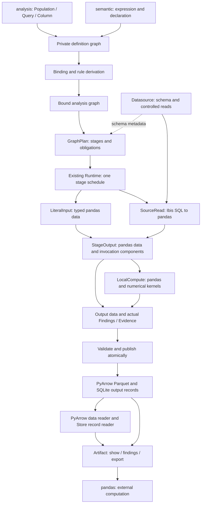

# Analysis 模块架构与实现分层方案

Date: 2026-10-14

Status: proposed v0.10，基于工作树中的语义表达式与 Lazy Analysis DSL v0.35。
本文是独立的目标实现架构，不是当前实现说明，也不表示任何重构阶段或后端验收已经完成。
本文与目标设计和实施计划同步命名；不修改实现、测试、技能或发布文档。
v0.7 收敛执行分工：Ibis 负责源端计算，pandas 统一本地执行，PyArrow 只负责存储和读取。
v0.7 延续 v0.6 的终端 Artifact：所有 DSL 组合在 Query 上完成，保持当时 v0.32 的 API 与数值合同。
v0.8 同步 v0.33 的统一零分母政策、旧模型声明处置和理论/实现定律编号；其余执行分工保持。
v0.9 对齐 DSL v0.34：明确时间样本规约、比较/份额/窗口边界、来源类型准入、普通观察 Evidence 和 Population 披露。
v0.10 落定完整元组谓词、分阶段准入和浮点优化边界，同步时间与格式切换合同；移除资源预算设计。
Artifact 保存输出数据、必要描述与实际 Finding/Evidence；不携带语义对象、图或内部组件，不进入后继 DSL。
新产物与重开产物统一引用已提交的 Parquet 和输出记录；发布前 pandas 数据不成为 Artifact 的另一种存储形态。

实施进度：R2.4 已接通私有数值路线及计算字段、单值路径、精确版本锚点、
解析/民用日期/naive 时间、编码 Duration 的准备；不同 datasource 根先分别规约后组合。
普通原生字段 semantic Metric preview 复用数值内核；路径/锚点和 Population preview 在连接前拒绝。
R2.5 已接通公开 Query.execute、Store 10 原子终端发布与无图输出记录；返回已提交身份。
公开打开、预览、导出与 Finding/Evidence 阅读仍报告 R2.6 缺口；不构成完整 R2 或远端 Runtime 验收声明。

## 1. 架构结论与文档边界

Analysis 应实现为一个**消费统一定义图的、有明确观察绑定和终端产出边界的执行系统**。
内部以“完整坐标上的多个量”为基本数据模型，以“定义、绑定、物理计划、已提交信息”区分计算阶段。
公开的 Population、Query、Artifact、Column 是这些结构的薄封装；不再按数值种类、方法和物化状态派生整套接收者类。

Population 表示分析总体，覆盖身份名单、分析坐标和内部样本；其业务含义与类型合同由
[DSL 对象模型](lazy-analysis-dsl-redesign.md#2-对象模型与-lazy-状态) 拥有。
语义层业务 Domain 及 domain= 命名空间保留；本方案的目标类型、依赖角色和目录统一使用 Population/population。

核心决策如下：

1. **一份私有定义图。** 行、Metric、Population 和 Query 的闭合定义可以相互引用；Artifact 和活动运行服务不能成为定义输入。
2. **两个绑定位置。** semantic 决定表达式阶段、单位、权限和依赖；analysis 决定本次贡献、坐标、期间、身份约束和归属。
3. **一个终端产物。** Query.execute 返回 Artifact；它包含多量数据和实际 Finding/Evidence，只读、展示和导出。
4. **一条编译执行链。** 沿现有 graph、MethodRegistry、GraphPlan 和 Runtime 改造；来源 Ibis 返回 pandas，本地只使用 pandas 交接与现有数值内核，PyArrow 留在存储/读取边界。
5. **执行内管理中间信息。** 充分组件、配对状态、局部同输入保证和物化屏障由本次计划管理，不附着于 Artifact。
6. **执行后交 pandas。** 不提供 Artifact DSL 续算、固定结果输入或历史图恢复；业务解释、重用和重新求值由脚本决定。
7. **按能力贯通实施。** 定义、检查、执行、输出保存、阅读和披露一起交付，不先铺空抽象。
8. **减少不必要的工作。** 元数据重开不扫描行，有界预览按需读；compiler 做有限需求传播和融合，执行器不重新选路。

本文规定代码应该如何组织、关键类型怎样交接、执行如何贯通；公共签名和计算意义仍由以下 owner 决定：

| 依据 | 拥有的事实 |
| --- | --- |
| [语义表达式设计](../semantic/expression-model-redesign.md) | 行/Metric 阶段、声明和收录、业务授权、算子政策、per 内部样本 |
| [Lazy Analysis DSL](lazy-analysis-dsl-redesign.md) | Population、观察、结果操作、时间窗口和公开能力边界 |
| [执行与结果交接](lazy-analysis-dsl-execution.md) | 实际读取、默认保存、冷恢复、披露和 pandas 布局 |
| [核心代数](algebra-theory.md) | 坐标映射、贡献出现、规约、信息充分性与有条件的规律 |
| [场景验证](lazy-analysis-dsl-scenario-validation.md) | 独立预期、关键反例和未来验收条件 |

已提交 semantic 合同的替代范围与切换条件由
[语义提案附录 A.1](../semantic/expression-model-redesign.md#a1-拟替代的已提交合同) 拥有；
旧 Python 模型参数/表达式的拒绝独立于 Artifact 格式切换，不能只删除持久化 codec 就声称完成收敛。

已有本地实施计划 `docs/superpowers/plans/2026-10-13-lazy-analysis-dsl-redesign-implementation.md`
继续拥有 R1–R8 的工作包与验收顺序。本文补足其架构决策和代码落点，不重写该计划、重复维护验收台账，
也不把这个被 Git 忽略的文件作为分发文档的必要依赖。本文与目标语义发生分歧时，先修正架构，不反向改变语义。

## 2. 当前实现：保留的基础与必须调整的结构

架构起草时的静态核对基线为 `main`，HEAD `970a5df89f7cd62b809f7b948e920a1e8cff94f0`。
两份设计稿及关联文档含已有工作树修改，目标合同以本轮 v0.35 为准；以下代码定位是改造起点，不是目标行为。
当前行为仍由 [Python Analysis Design](python-analysis-design.md) 和
[Session State and Runtime](session-state-and-runtime.md) 约束。

| 现状与代码证据 | 架构判断 |
| --- | --- |
| [public_dsl.py](../../../marivo/analysis/public_dsl.py) 约 5,900 行，公开 Logical/Materialized、多种数值关系及专用方法结果 | 重做公开对象组织；减少按结果形状增殖的类，不把旧类逐个换名成 Query |
| [core/model.py](../../../marivo/analysis/core/model.py) 的 Signature 只有一个可选 quantity，parts 也围绕该量绑定 | 先改多量合同，再接 observe 的命名映射；不能以多张单量结果临时拼接模拟多量 Artifact |
| [core/graph.py](../../../marivo/analysis/core/graph.py) 已有 SourceLeaf、FixedLeaf、角色边、定义指纹、capture 和拓扑；图构造直接依赖规则和注册表 | 保留来源、角色边与拓扑能力，退役 FixedLeaf；分离纯定义记录与 analysis 绑定推导，避免 semantic 依赖执行层 |
| [semantic/metric_graph.py](../../../marivo/semantic/metric_graph.py) 有 CatalogBody、Aggregate、Ratio、Linear；另有 RuntimeMetricExpr | 统一行/Metric 定义，消除模型与临时表达式的双入口；复用算法，不保留两套计算图 |
| [materialization/graph_relation.py](../../../marivo/analysis/materialization/graph_relation.py) 同时组织 lazy 构造、观察、恢复和 Runtime 依赖 | 纯构造迁入绑定层；终端产物重开留在存储/读取层；materialization 不再拥有公共代数 |
| [core/rules.py](../../../marivo/analysis/core/rules.py) 约 4,000 行；[graph_lowering.py](../../../marivo/analysis/compiler/graph_lowering.py) 约 4,660 行 | 按定义族拆规则和 lowering，保持各自唯一入口；不增加第二注册或分派框架 |
| [graph_plan.py](../../../marivo/analysis/compiler/graph_plan.py) 当前拒绝 mixed 和多个 live datasource | 退役 Artifact 输入路线；为来源/字面量的执行内依赖建立 stage 交接与资格；删除拒绝条件本身不能构成支持 |
| [graph_publication.py](../../../marivo/analysis/materialization/graph_publication.py) 已管理执行、Run、资源、原子提交；[store.py](../../../marivo/analysis/materialization/store.py) 已有本地持久化 | 保留事务与资源边界，改其消费的计划和多量布局，不重建 Store 或协调器 |
| [SourceSession.execute](../../../marivo/datasource/adapters.py) 已通过 Ibis 返回 pandas；固定执行和 Cell/Parquet 编码已有独立边界 | 保留 pandas 来源交接；统一执行内 pandas 数据合同，PyArrow 只承担产物编解码与读取；不重新引入 cursor、batch 协议或来源临时表体系 |

现有闭合格式为 Store 9、graph DAG v10、descriptor v6、continuation v5。
这些是源码核对结果；旧模块中的历史注释不能替代实际 schema。格式切换见 §12。

现有 forecasting、association 等实现不因目录重排而批量删除。它们退出本次目标公开面，
内部仍有消费者的数值、资源或历史读取能力按实际依赖处理；没有新增这些能力的验收承诺。

### 2.1 关键技术选择与工程起点

下面是本方案唯一的执行分工。其目标是在现有依赖与执行链上减少全量读取、
逐 Cell Python 对象、重复转换和重复编译；不以目录拆分本身作为效率改进。

| 实现点 | 选择及原因 | 当前落点与改造边界 |
| --- | --- | --- |
| Artifact 元数据 | SQLite 存产物 ID、data schema、receipt、必要描述及有界可分页的 Finding/Evidence；不存定义闭包 | [graph_store.py](../../../marivo/analysis/materialization/graph_store.py) 已有 artifact_metadata；恢复句柄只消费这类路径 |
| Artifact 数据 | ArtifactData 只描述已提交的 Parquet 主表及坐标投影/展示次序等输出附件；PyArrow 负责读取和编码 | [graph_storage.py](../../../marivo/analysis/materialization/graph_storage.py) 的 read_result 目前读全主表、校验并加载所有 parts；改为按请求打开，见 §12.5 |
| 内部值 | 类型化 nullable 列；来源使用 SQL NULL，本地使用统一 pandas dtype 与缺失表示 | 新格式移除 CellBook、三种 carrier、int16 状态列和独立 Cell lowering；Arrow validity 只属于存储/读取布局 |
| 来源计算 | Ibis 构造关系表达式，沿 SourceSession.execute 返回 pandas | 不引入另一套 SQL 生成器或 datasource 流协议；来源过滤、关联、规约优先在已准入后端完成 |
| 执行内本地计算 | pandas DataFrame 是唯一阶段交接容器；投影、筛选、关联、规约和组合共用本地内核，精确算法复用现有数值函数 | [graph_local_execution.py](../../../marivo/analysis/materialization/graph_local_execution.py) 逐能力收敛；不新增 Arrow compute 或 DuckDB 本地执行分派 |
| 优化 | compiler 中有序、有限的规则 pass；后端自行选择索引、join 算法等物理策略 | 现有 fixed selection 与 original-reduction fusion 已实际调用 local_laws 检查；把分组决策移入编译计划，不另建优化注册表 |
| DuckDB | 仅作为已声明 datasource 的 Ibis 后端，包括其已有文件来源能力 | 不将中间 pandas 表或 Artifact 注册到隐藏 DuckDB 连接，不设第二条本地执行路线 |
| 大型本地关联/排序 | 明确采用内存计算，尽量在来源裁剪列、过滤和合法规约；不自研外部排序或磁盘 hash join | 不承诺超内存执行，不因资源不足自动换引擎、扩大来源读取或截断答案 |

当前环境静态核对为 Ibis 12.0.0、PyArrow 25.0.1、pandas 2.3.3、DuckDB 1.5.3、SQLGlot 30.8.0。
[pyproject.toml](../../../pyproject.toml) 的声明范围更宽，尤其 PyArrow 下限为 10.0.1；这些版本是本次观察值，
不是新的最低版本或完整兼容矩阵。选用 API 必须在声明范围验证，必要升级依赖须在实施时明确提出。

来源交接统一沿 SourceSession.execute，不以 Ibis to_pyarrow/to_pyarrow_batches 作为执行协议或流式保证。
编译器在来源 Ibis 和本地 pandas 之间安排阶段，不维护 pandas/Arrow/DuckDB 本地引擎选择矩阵。
PyArrow 可以按列/行组读取或按批编码终端产物，但不接受 DSL 节点、不执行业务谓词或规约。
这些限制针对 Marivo 自己的 lowering、调度和交接边界，不限制 Ibis 后端或 pandas dtype 的内部实现；
依赖内部使用 Arrow 不产生另一条可选执行路线，也不构成无复制或流式保证。
这一取舍保留无 DuckDB extra 的产物读取路径，并明确接受本地 DataFrame 与中间副本的内存成本。

## 3. 总体分层与依赖方向

### 3.1 数据流



图表示数据流，Python 依赖遵守下表。编译器产出计划，不调用 Runtime；Runtime 消费编译产物。
LocalCompute 可按计划分为多个 stage，后一个只消费已完成的 pandas StageOutput。
只需来源计算的计划可直接投影发布；Artifact 没有返回定义图或 Runtime 的边，读取层与执行内数据消费层分开。

| 层 | 核心输入 → 输出 | 可以依赖 | 不承担 |
| --- | --- | --- | --- |
| 私有定义 | 已解析语义引用/不可变参数 → 闭合定义图 | 基础 Ref、时间和值类型 | Catalog、I/O、规则注册、执行资格 |
| semantic | 定义 → 表达式事实、声明、可收录版本 | 私有定义、语义规则 | analysis 执行器、本次输出键、Run |
| analysis 公开封装 | 用户调用 → 定义或已绑定 Query 句柄 | 定义、绑定、Session 的执行/读取入口 | SQL、DataFrame 算法、存储格式判断 |
| analysis 绑定与规则 | 定义 + 显式上下文 → 签名、映射、待检查条件 | semantic 的已解析事实、core、唯一方法注册入口 | 读取业务行、选择业务口径 |
| compiler | 已绑定图 + schema/资格 → GraphPlan/LoweredPlan | core、方法资格、来源绑定描述 | 执行 SQL、读取 Artifact、建 Run、发布 |
| materialization | 计划 + 来源/字面量输入 → 已验证输出、已提交 Artifact | compiler、datasource、local kernels、Store | 重新推断计算意义、换算法重试 |
| 读取与披露 | Artifact manifest、数据与输出记录 → show/findings/pandas | 数据 reader、只读 Store 和渲染 | 构造 DSL、加载图、刷新 Catalog、产生新结论 |

共享基础类型位于私有模块，避免 `semantic → analysis → semantic` 的导入环。
规则函数不导入 Runtime，数值内核不访问 Store；Help 和渲染不成为计算依赖。
Session 是资源与归属入口，不能成为藏有所有绑定、编译和规约逻辑的服务大类。

### 3.2 四种内部表示

| 表示 | 回答的问题 | 生命周期 |
| --- | --- | --- |
| DefinitionGraph | 用户定义了什么，精确依赖及政策是什么 | 进程内不可变结构；不进入分析结果持久化 |
| BoundGraph | 此次问题如何绑定贡献、键、量和必需检查 | Query 构造与 invocation 准备；引用定义，不复制公式 |
| GraphPlan / LoweredPlan | 哪些来源 Ibis 与本地 pandas stage 按何种依赖、布局和检查求值 | 单次调用内；不包含本地引擎选择或 Artifact 读取，不作为可重放对象保存 |
| ArtifactData + ArtifactManifest | 这次输出了哪些数据，如何读取 | 新产物与重开产物共用合同；manifest 不含 logic，Finding/Evidence 为输出记录 |

这四种表示是现有定义、推导、计划和保存职责的明确化，不是四套计算语言。
不得在每一层重建另一份 Metric AST，或把 manifest 当成可以重新执行来源的程序。

## 4. 共同私有定义图

### 4.1 位置与闭合节点族

将 semantic 的 Metric 图与 analysis 图中可脱离运行环境的定义记录归拢到拟建的 `marivo/_definition/`。
保留 `analysis/core/graph.py` 作为绑定图、invocation capture 和执行依赖遍历的 owner；
它引用共同定义；共享结构不要求建立一套持久化图 codec。

| 定义族 | 首期节点范围 | 含义 owner |
| --- | --- | --- |
| Row | FieldRef、有限数值常量、Negate/Add/Subtract/Multiply/Divide、Measure 语义断言 | semantic |
| Metric | SourceAggregate、EntityCount、SourceWeightedMean、算术、ContributionFilter、PerReduce、PerWeightedMean、MemberCount | semantic；MemberCount 的实际身份绑定归 analysis |
| Population | 字面量键、来源身份选择、集合/投影/积、坐标筛选、classify/image/preimage、QueryKeys | analysis |
| Query | Observe、PopulationRows、ReadFields、Values、select/where/top/reduce、rollup/drill、align/compare/share | analysis |
| 结果标量与谓词 | 绑定 Column/坐标引用、字面量、有限算术、比较、状态测试、域测试和布尔组合 | analysis |

上表是私有封闭变体，不对应新增公共类。语义声明的局部名、domain、ai_context、源码位置放在声明记录中；
仅命名不增加计算节点或改变计算指纹。Measure 新增的单位/可加断言则进入语义定义，并保留授权来源。
算子默认政策在构造时规范化，进程内节点持有明确政策及规则版本；冷存只记录完成值，不恢复这些节点。

行、Metric、结果 Column 的算术可共享数值政策实现，但必须有不同的阶段类型。
禁止使用一个 `Expr(stage: str, payload: object)` 承载所有阶段，也不提供任意 op 字符串或回调扩展口。

### 4.2 Population 依赖如何跨层

Metric 捕获 Population 时只抽取其规范描述，采用两个闭合依赖变体：

- `LiteralPopulation`：有序轴、完整键、相等性与版本；没有预设 Session。
- `PopulationProgram`：完整 lazy 定义根及依赖闭包，保留自己的选择期间、属性锚点和已有归属。

公共 Population 对象、活动 Session、Catalog、Ibis 或 Artifact 对象都不进入这些记录。
`Query.population()` 可能来自 observe 后的 where/top，因此 PopulationProgram 必须能引用 Query 定义；
不能将它缩成“某 Entity 加一个筛选条件”，也不能把这条依赖藏成不透明 Python 对象。
这正是共同定义层需要理解 Population/Query **数据结构**的原因；它不需要执行这些节点。

通用拓扑遍历能发现 `Metric → PopulationProgram → Query → Metric` 的真实循环和跨 Session 组合。
模型收录只检查闭包的独立可解析性，不执行 Population、不剥除归属、不复制名单来使收录通过。
带 Session 归属的逻辑域参与临时 Metric 不因此获得模型收录资格；Artifact 键引用不是域变体。

### 4.3 身份、边和指纹

2026-10-15 定义更新原则：下表记录“实际使用了什么”，不要求constructed输入始终匹配其原定义版本，
也不因同路径定义已更新而单独拒绝输入；变更后果由agent/用户承担。解析消费者使用其完整作用域，
不可变表达式不做live refresh或module replay。四类责任分开：

- 原定义版本的强制绑定/冲突拒绝已取消，不需要为此在helper/copy中保留隐藏约束。
- Ref/定义身份与计算/依赖指纹仍表示实际消费的内容、政策和有序边，不因取消拒绝而按路径折叠为同一含义。
- cache/plan复用必须与实际消费的定义、绑定和规则一致；改变依赖时使用正确新键或失效，不能以用户承担语义变更为由复用错误缓存。
- 持久化provenance、检查记录、认证snapshot和输出文件各由既有owner管理；本决定不删除或伪造记录，也不新增Artifact语义快照。

保留物理capture/finalize用于default-time/coordinate完整性和合法Ibis前向闭包，
不将其扩展为版本生命周期框架。source-row的snapshot/validity选择、轴角色和类型/单位/粒度等检查仍独立有效。

| 身份 | 用途 | 不证明 |
| --- | --- | --- |
| 语义 Ref + 实际定义身份 | 本次表示的 Entity/Field/声明含义 | 必须匹配构造时原版本、当前来源内容或来源可用性 |
| 计算指纹 | 规范表达式、政策、依赖和授权相同 | 相同读取、贡献包含、相同答案 |
| 节点 ID + 有序输入角色 | 某次图构造及重复使用位置 | 一次物理扫描 |
| 轴绑定 ID | 完整坐标的 Entity/字段、路径、角色、版本/日历 | 仅凭同名轴可以对齐 |
| 实际 stage 输入实例 | 某个算子实际消费的数据 | 整图共同快照 |
| Artifact ID | 精确已提交答案 | 可回放来源或重建丢失状态 |

`m + m` 保留两个有序使用位置；进程内共享同一不可变定义，但不能将加法去重成一次使用。
域中的键允许集合去重，贡献出现不能因键相等被去重，重叠窗口还须保留输出目标。

Observe 消费 Metric 时展开其来源和域依赖；拓扑遍历只覆盖当前 Query 的真实输入。
Artifact ID 只定位阅读对象，不是执行边；说明性输出引用不能被提升为 DataLeaf。
绑定图中的 SourceLeaf 对应明确的贡献来源和绑定，不把一个含多个根/域的复合 Metric 压成单一来源叶子。
members、output_population、samples、predicate_population、reference 等实际输入按节点的闭合角色进入依赖边；
不能只遍历主接收者，另在某个参数或辅助 sources 列表中藏一份执行器才知道的依赖。
分析规则需要的子指标定义引用仍然保留；中间状态只在本次计划内传递，不从历史 Artifact 补齐。
不建立分析图的持久化 codec，也不在 Artifact 协议旁存 sidecar 图、语义快照或可重新加载定义的 Ref 闭包。
编译指纹仅用于本进程的合法计划复用，不能据此寻找旧结果或恢复历史意义。

## 5. Analysis 的基本数据模型

### 5.1 终端数据与执行内状态分离

现有 Signature 的数据布局与语义推导事实分离。以下是私有精确类型，复用既有数据容器和记录家族：

```text
ArtifactData
  schema: DataSchema
  rows: ParquetHandle
  coordinate_projections: tuple[DataProjection]
  order: CanonicalOrder | StoredRowOrder

ArtifactPublication
  schema: DataSchema
  final output rows and data attachments as pandas tables
  findings: output records
  evidence: output records
  artifact_id / session_id / run_id

Artifact
  artifact_id / session_id
  manifest and read service

StageOutput
  typed schema and keyed pandas DataFrame
  required intermediate components as keyed pandas tables
  completed checks
```

DataSchema 只含有序轴/列、完整键形状、物理类型/精度、nullability、单位文本、必要时区和实际边界。
数据轴 token 用于定位导出列，不是能加载 Entity/Field/Calendar 的语义 Ref；对应投影与 presence 是数据。
Finding/Evidence 采用已有输出记录家族的无图版本，详见 §12.1；它们不进入 DataSchema 或运行权限推导。

BoundGraph 的签名仍持有 BoundAxis、QuantityDefinition、政策、证据和 obligations；只由 Query/执行计划拥有。
StageOutput 按计划传递组件与检查，发布时投影成 ArtifactPublication，禁止把整份 Signature 或 StageOutput 序列化。
Artifact 不持有 Query、BoundGraph、组件或执行上下文；writer 的参数也不能接受这些对象。
StageOutput 的 DataFrame 由 invocation 拥有，消费者不得原地修改共享输入；阶段执行不往返 Arrow 或逐行字典。
ArtifactPublication 是一次临时写入请求，只包含最终输出，不是已保存的 ArtifactData。
writer 将其 pandas 表编码为 Parquet，发布器提交成功后才返回 ArtifactData/manifest 的只读句柄。
Arrow Table/RecordBatch 仅在编解码调用内使用；不为 Artifact 增加内存 Arrow 缓存或第二 reader。

### 5.2 统一产物生命周期

Query 构造后可继续组合；execute 完成全部必要计算和检查，原子发布 Artifact，然后释放 invocation 中间资源。
若调用方仍持有 Query，其定义继续存在，但与 Artifact 没有计算依赖或自动结果缓存关系。
再次 execute Query 是新求值；Artifact 的精确 ID 只用于重新打开已提交输出。

新产物与重开产物都从已提交 Parquet 和输出记录读取；execute 不返回仅驻内存的成功产物。
发布完成后释放临时输出表和编码对象；Artifact 仅持存储引用，不建立 OriginContext/FixedContext/ColdContext 或能力分支。
刚 execute 后的阅读也承担文件读取和解码成本；以此保持唯一的读取、校验与隔离路径。
数据、Finding/Evidence 和读取接口必须往返相同，任何产物都没有 DSL 方法或 contract。

空表、仅键表、完整复合键、nullable dtype、presence、规范键序和 Top-N 次序一致。
零轴 `{()}` 与空集由实际行数区分；不添加公开占位量，也不把输出键反向包装成 Population。

### 5.3 Nullable 值、presence 与检查

逻辑值为类型化 value 或 NA，物理上只有一列 nullable value；不再有逐格状态码、原因码和 carrier 变体。
普通 NA 的来源不保留；sum 忽略 NA，空输入与全 NA 都为 0，不为区分两者保存隐藏支持计数。
outer 的缺侧仍用非空 boolean presence 和端点投影表示；presence 不由值是否为空推断。

必要检查属于算子与执行计划：nulls="error"、显式 zero_denominator="error" 下共同非 NA 输入的零分母、
有限性、结构与实际日历/映射/请求域覆盖检查。
检查失败使本次 execute 失败，不发布混合成功/失败格子的 Artifact，也不把错误转成可忽略 NA。
默认或显式 zero_denominator="null" 将共同非 NA 输入的零分母变为普通 NA；其来源不影响后续运算。
行/Metric/Column 的 Divide、share、compare.relative 和 weighted_mean 共用
[语义 §3.4](../semantic/expression-model-redesign.md#34-样本政策的归属)；参数只作用于本节点，
不为 Session/observe/execute 建政策覆盖层。定义捕获时解析默认，规范化指纹包含实际政策及规则版本。
保留已有 consume/publish 截止位置、结构化错误和有界坐标样本，不增加通用验证平台。
空域、乘零、row_count、select 丢列或后置 where 不得删除原问题必须完成的检查。

### 5.4 Nullable 的物理计算

| 执行边界 | 物理表示与运算 | 额外工作 |
| --- | --- | --- |
| 来源 SQL / Ibis | 原生类型化 nullable value；sum 显式 coalesce 到 0 | 仅对合同需要的输入生成违规检查，不为每个表达式生成 state/reason CASE |
| 本地 pandas | 按统一 schema 规范化的 DataFrame、nullable dtype 与缺失 mask | 比较、算术与筛选使用列式操作；共同配对使用同一 mask，精确数值算法仍由原内核拥有 |
| 冷存 Parquet | 输出 nullable value、独立 presence、坐标投影和展示数据 | 不写 CellBook/state/reason，不做 carrier 推导或 remap |
| 展示 / 导出 | 从 value 的缺失性显示 NA；检查失败显示结构化错误 | 不构造 N×Q 个 Python Cell 对象，不恢复已放弃的缺失原因 |

Arrow validity 是存储/读取布局，pandas mask 是本地计算布局，Marivo 不再定义第二套编码协议。
绑定类型确定后复用原生数组，不能因 NA 将 int64/Decimal 强制转为浮点；格式转换只放在必要边界。
来源 schema、后端及驱动/Ibis 转换路线的类型合同由 datasource 拥有，物理准入检查所需精确类型是否有合格路线；
已知有损或无法保证必需精度时拒绝，不能只凭 Ibis 可执行接纳。完整责任边界由
[执行 §1.5.1](lazy-analysis-dsl-execution.md#151-来源类型准入与无损交接)拥有。
来源返回与字面量输入在同一入口按已知 schema 规范化列序、完整键、dtype、时区和缺失表示；
执行入口检查实际返回布局及必要值约束，本地算子不各自猜类型或利用 pandas index 对齐。
schema-only 只检查类型与路线资格，不检测具体值是否已经损失精度；类型规范化或事后 cast 不能恢复该损失。
已接收类型化值的阶段交接、产物存储和导出保持无损表示，数值计算仍服从各方法合同。

source/local 共用已解析的政策与检查描述，各自 lowering 数值操作；sum 使用忽略 NA 后的和及单位元 0，
mean 保存非 NA 的 sum/valid_count；无需通用 sample_count/null_count 或逐格原因。
nulls="error" 的检查需要时可计算临时 NA 计数，但通过后不作为 Cell 状态保存。
配对空集产生 NA，非空配对权重和为零按政策检查；两者仅需 weighted_mean 自己的 valid_pair_count。

除法先生成有效输入 mask 与必要零分母检查，再使用安全分母或只计算合法 mask；
不依赖 CASE 的绝对短路保证，不先生成 inf/NaN 再推断缺失原因。
默认 null 政策将零分母位置设为 NA；显式 error 的检查不能因下游不读取该值而被裁剪。
任一操作数为 NA 时两种政策均传播 NA；compare 的 relative 为 NA 不影响有效 absolute 的计算，
但显式 error 或输入子式的失败仍阻止整次发布，不返回部分成功结果。
本地复用已准入的精确数值内核；int/Decimal/Duration 的溢出、精度和 float 求和次序仍受方法合同约束。

### 5.5 执行内组件与输出布局

中间状态只服务本次执行，包括计划内的合法上卷、份额和内部样本求值；它不附着于 Artifact。
原量完成值投影为 ArtifactPublication 的输出，提交后由 ArtifactData 描述；组件按量绑定为列式块，只根据实际消费者需求计算和保留。
存储没有默认组件文件；跨执行需要它们时，脚本显式声明为输出量。

| 计算族 | 同一次贡献处理可产出的物理组件 | 必须保留的区别 |
| --- | --- | --- |
| 来源 sum/mean | sum 只需精确和；mean 需精确和及 valid_count | 不保留空输入/全 NA 区别；严格检查在 ignore 前完成，计划内合并仍需相同贡献与政策 |
| 来源 min/max/count | nullable 极值或对应计数 | 空/全 NA 的极值均为 NA；count 按自身样本单位合并 |
| weighted_mean | valid_pair_count、sum(value×weight)、sum(weight) | 分子、分母共享同一配对 mask；空配对与有效配对的零权重和分开 |
| Metric 算术/ratio | 子组件的精确引用和需要保留的实际状态 | 可共用同一物理组件，公式中的两次使用和角色仍分别存在 |
| PerReduce / QueryReduce | 各自样本空间中的已准入状态 | 不能因为物理列都是 sum/count 就替代来源状态或隐藏内部样本信息 |

同根、同贡献/过滤/期间/配对合同的组件可以在一条聚合中一起计算，减少重复扫描；
不同根先分别规约，禁止关联明细后同时聚合导致贡献倍增。小型违规计数能与该消费者的聚合同读时，一并返回；
检查需要不同作用域时保留单独计划及证据，不能从另一读取的成功推断本次输入已检查。

执行内组件按完整键和相同运输合同组织宽列，由量 ID、组件 ID 定位。
只有键、输入绑定和运输/删除规则一致的状态才放在同一内存块；不同细度分别持有。
多个量引用同一物理组件时共享不可变引用；需求裁剪取消费者并集，不按显示标签去重。
组件按消费者计数释放；只有本次操作确实需要且有合格路线时才物化内部细网格或精确分布。

## 6. 公开封装、Session 和绑定层

### 6.1 公共对象保持薄且不可变

| 对象 | 内部持有 | 方法所做的事 |
| --- | --- | --- |
| semantic Field/Measure/Metric | 共同定义引用、已解析语义事实、独立声明信息 | 构造同阶段表达式；不执行、不注册临时量 |
| Population | Population 定义引用、有序轴及已有归属 | 构造域运算；通过 Session.query 唯一物化 |
| Query | Query 定义根、已绑定合同、所属 Session 执行入口 | 构造后继或显式 execute |
| Artifact | 精确 ID、输出 manifest 和只读服务 | show/to_pandas/findings/evidence_digest；不构造表达式 |
| Column | 所属输入域标识、列/坐标引用、闭合值表达式 | 同域运算；不持有可单独执行的 DataFrame |

公共包装可持有所属 Session 的运行服务引用；可编码定义不能捕获该活动对象。
DSL 方法仅属于 Query，不与 Artifact 共享操作协议或继承树。
Artifact 只读输出；所有 DSL 入口以具体类型拒绝 Artifact，不增加转成 Query 的适配器。
Column 采用一个公开接口、内部闭合 kind，不按动态列名承诺 Python 可以推导全部 schema。

### 6.2 Session 只做三类事情

1. 持有项目/Session 归属、已保存时区及运行/产物读取服务。
2. 将 observe/members/query/values 的请求交给绑定层；精确 artifact(id) 交给恢复层。
3. 保留已有 Session/Run 历史与有界读取；不因 DSL 重构复制另一套历史存储。

目标 Query 构造完成可从声明判定的阶段、路径、单位、域形状和 Session 检查。
尚未解析的物理 dtype 使用明确的未解析状态，在 execute 的 schema-only 准备边界解析后才选择物理实现；
同时按 §5.4 检查来源转换路线的精确类型资格，不把未知类型写成 Any，不扫描值猜类型。
repr/contract 和模型加载都不触发这个边界。
检查按[执行 §2.4](lazy-analysis-dsl-execution.md#24-检查时机与能力披露)归属构造、绑定、执行准备或实际输入。
已知不相容单位等非法输入不能保留到执行；尚缺绑定/schema/数据则披露具体要求，不以未知冒充支持。

### 6.3 绑定层的产物

建议将 [observation](../../../marivo/analysis/observation) 和 graph_relation 中的纯构造归拢到 `analysis/binding/`。
它保存一次观察的不同角色，而不是一个到处转发的通用 context 字典：

| 绑定记录 | 内容 |
| --- | --- |
| ObservationBinding | 命名 Metric、期间/窗口、共同条件、可选 members、输出域请求 |
| ContributionBinding | 每个来源规约出现的根、固有条件、共同条件、时间角色和身份归属路径 |
| CoordinateBinding | 完整输出轴、各根到输出键的单值分类，以及目标域模式 |
| SampleBinding | 每个外部 k 内的 J_k，Field 推导或显式 Population，及贡献到 (k,j) 的绑定 |
| PredicateBinding | 接收者确定的身份/字段元组/已有结果坐标测试，以及明确域依赖 |

不存在的 members 是独立变体，不以空 Population 代替；普通分组、完整身份输出、完整日历和显式目标域也分别表示。
共同 where/during 只施加到本次观察的适用贡献组件，不改写已捕获 Population 的选择程序。
主体路径由语义唯一路径解析，Field.via 只承担字段读取，绑定层不选最短或最低成本主体路径。

## 7. Observe 与内部样本的求值组织

### 7.1 普通多量观察

一次 observe 的逻辑处理次序如下；允许融合物理操作，但必须保持这些含义和检查：

1. 解析 Metric 依赖闭包，保留每个来源规约出现及显式域依赖；常量不制造来源。
2. 绑定每个根的固有条件、共同条件、时间角色、可选身份限制和字段路径。
3. 为各根构造完整输出分类；从所选贡献的键像或显式请求确定共同输出域 K。
4. 在各根自己的贡献关系上求量和必要支持信息；不同事实根先分别规约。
5. 将各组件补齐到 K，在成功读取且无贡献时按该组件的规约规则完成。
6. 逐键执行 Metric 公式，组装命名量，保留组件、政策、nullable 值及证据。

多根收入/退款不能先 join 原始事实再 sum。组件完成值按完整键组合，不能以某一个根的键集覆盖其它根。
源 Null 被规约忽略时，其分类键仍在键像中；字段 Null 归 None，缺字段映射不伪造成 None。
by=Population 的覆盖检查针对实际被消费贡献，不能先做 inner join 将域外贡献删掉后宣称覆盖完整。

内外键处理是独立的窄步骤：键域关系只承载轴/键，组件关系承载该根的键/值/状态，最终才组装多量表。
它们是同一计划中的关系，不是需要分别发布的多个 Artifact。
键和值来自该组件的同一合法分类输入，不能一个扫描求键、另一个扫描求值后忽略相互约束。

### 7.2 per 使用展开键，不做全局客户预聚合

`m.per(samples).mean()` 的中间域是 `(k,j)`：先在一个外部格子 k 内为每个样本 j 完成整个 m，
再对这些完成值求 mean。建议用一个闭合 PerReduce 定义，由编译器展开成键准备、子指标求值和外层规约阶段。
不要把 per 编译成“先在全局算客户均值，再把它 join 到地区”。

```text
external output K
  -> sample keys J(k)
  -> expanded coordinates (k, j)
  -> evaluate each child metric at (k, j)
  -> finish the complete child formula
  -> apply the outer reducer within each k
  -> output one nullable value per k
```

| 样本入口 | J(k) 的取得方式 | 必须保留的区别 |
| --- | --- | --- |
| per(Field/字段元组) | k 内相关贡献根完整字段键像的并集 | 键像不因某个组件没有有效值而缩小；未出现类别不补齐 |
| per(Population) | 显式域中与 k 相容的全部键 | 域外贡献不属于问题；名单内无活动样本仍按子指标政策完成 |
| per(状态 TimeField) | 声明采样合同在本次期间所要求的样本 | 明确缺测传播，不以实际出现时点替代应有采样 |

共享轴必须取相等键；同一 j 可出现在不同 k，不要求 j 唯一决定 k。
显式内部域不创建额外外部格子。合法零轴非空域产生每个 k 的一次子求值，零键域没有内部样本；
两者都不等于子指标空贡献。Field/Member 复合域按完整绑定能力准入，首期内部 Calendar/Correspondence 样本仍不支持。

例如 P={A,B}、全来源 A=100/C=300、收入 sum 空/全 NA 为零：
`revenue.per(P).mean()` 得 50；`revenue.per(CustomerId).mean()` 得 200。
per(P) 的域外 C 不进入内部求值；observe(by=P) 则仍要求先限制贡献，否则输出缺 C 应失败。
该反例决定两种绑定记录不能合并。

### 7.3 配对与时间样本规约

SourceWeightedMean 在同一贡献根形成共同有效配对，乘积和、权重和、支持数使用同一掩码。
PerWeightedMean 先在相同 `(k,j)` 完成 value/weight 两个 Metric，再共同配对；
其样本域包含两侧相关键的并集或全部显式域键。二者共享配对数值规则，不共享输入阶段或充分性结论。
归一化权重不要求业务可加授权，也不因此获得 share 的贡献证明。

状态 P95 的执行次序是“同一采样时点空间 sum → 观察期间内 quantile”。
两设备 A=[10,0]、B=[0,10] 的同时点总体 P95=10，各设备 P95 相加为 19。
绑定图须保存固定状态轴的要求直到整个 Metric 绑定完成；不能在中间 sum 构造时将要求丢弃，
也不能用两个完成 P95 或失去时点的 bag 做空间 rollup。

## 8. 规则、方法注册和编译器

### 8.1 语义规则与物理资格各有一个 owner

semantic 拥有行/Metric 的类型、单位、可加性、时间角色和节点政策；
analysis 规则拥有本次域、贡献映射、结果操作和保存信息的消费条件。
MethodRegistry 继续作为绑定方法与物理实现的唯一连接入口。

建议将 core/rules.py 按 population、observe、query、grain、temporal 拆成纯函数模块。
规则输入为闭合参数、精确绑定和输入签名，输出为现有 RuleDerivation 的演化版本：
输出签名、状态需求/运输、派生事实及 pending obligations。
规则模块不回调注册表；注册表引用规则，构造/绑定入口通过注册表调用推导，避免相互导入。

物理资格继续包含方法/规则版本、精确类型、输入域和时间形状、来源/字面量/本地 stage 形态、后端、检查和状态产出。
多量查询按所需列和各 stage 分别选择来源 Ibis 路线或合格 pandas 内核，不把“同一表里有一个 float”当作整表资格。
MethodRegistry 保留精确算法和类型准入，不新增本地 backend 协议或 Arrow/DuckDB fallback。
直接求值、生成本次所需组件和合法合并分别准入；输出能否编码由发布边界校验，不形成 Artifact 的续算就绪状态。

### 8.2 三种规约不能因名字相同而共享完整实现合同

| 方法族 | 消费的样本 | 语义与状态边界 |
| --- | --- | --- |
| SourceAggregate | 来源贡献出现 | 节点 nulls 政策；sum 保留和，mean 保留和与有效数 |
| PerReduce | 每个 k 中已完成子指标的 j 样本 | 子指标先完成；外部粗化可能需要内部身份及子状态 |
| QueryReduce | 当前完整坐标上的 nullable values | sum/mean 忽略 NA、row_count 的全部坐标计数 |

允许共享精确求和、除法、共同有效配对、nullable 运算等数值内核。
来源与本地 lowering 从同一个已规范化的政策描述产生各自操作，不再分别硬编码默认值。
禁止 `Reducer(name="mean")` 自动决定阶段、样本单位和保存状态，禁止给每个 reducer 强制要求通用 merge。

Query 上卷采用“本次输入准入 → 合并子量 → 原公式 finish”；直接求值采用合法完整输入。
没有低成本 merge 的 quantile/per 仍可直接计算。`revenue + 10` 的地区完成值 110/310 可由组件重算总体 410，
不能把完成值求和为 420，也不能因此给这个平移后的量授予 share。

### 8.3 编译流程

```text
capture definition and ownership
  -> derive and bind logical contracts
  -> schema-only source binding
  -> propagate required keys / nullable values / presence / parts / checks
  -> select exact implementations and stage boundaries
  -> optimize admitted physical groups and source projections
  -> lower source relations to Ibis and local operations to pandas kernels
  -> verify nullable layouts and preserve check scopes
  -> return an executable schedule with pending checks
```

上游构造已有的推导在 capture 时复用，不逐节点重复跑全量语义校验。
语义模型加载仍需结构、版本和归属检查；不将进程内对象当作任意恶意输入重新深审计。
schema 准备由调用入口委托 datasource 完成，结果以明确绑定传给纯 compiler；
lowering 不调用连接、SQL、Artifact reader 或 Store。

GraphPlan 保留阶段输入、输出标识和 consume/publish 检查截止点。
LoweredPlan 保留每个 emitted Ibis 表达式的精确来源 ID，不比较 Ibis AST 来猜来源。
布局从单值扩为完整 key、多个 nullable value slots、presence、状态 parts；稳定物理列 ID 与用户量名分开。

现有 graph_lowering.py 拆成入口加少量 owner 模块：来源/Metric 调度、域/坐标、结果运算、时间窗口、必要检查。
`semantic/metric_graph_lowering.py` 改造为唯一的行/Metric 纯 Ibis lowering 内核，
接收已经绑定的来源关系、字段、完整坐标、样本关系和节点政策；不解析活动 Session、Population 程序或 Artifact。
其输入/输出类型由该纯内核定义：输入为闭合的物理绑定，输出为 Ibis 值/支持/组件关系和所需检查描述，
不接收 analysis 的 Signature、RuleDerivation 或 Cell Python 对象。
`compiler/observation.py` 完成绑定记录到该输入的转换；内核直接发出 nullable 值和必要检查，
删除独立 cell_lowering carrier 重写阶段，避免从逻辑 tag/reason 表达式反推物理状态。
analysis 编译器负责先准备这些输入，再调用该内核；语义 preview 的合格路线复用同一内核，
不能留另一套默认政策或偷偷调用 analysis Runtime。需要新 Population 调度而 preview 尚无合格准备路线时，
明确报告该 preview 的资格缺口，不用模拟 Session 或隐藏查询补全。
semantic 的来源声明/Ibis 字段能力仍由原 owner 管理，不因新 Metric 语言而删除合法物理来源构造。

### 8.4 compiler 与 optimizer 的职责交接

optimizer 是 compiler 的一组私有 pass，由同一编译入口按固定顺序调用，不是 Runtime 中另一个自动选路入口。
保留原 DefinitionGraph/BoundGraph 的语义身份；优化写入 GraphPlan/LoweredPlan 的读取需求、融合组和节点来源映射，
不再维护第五套优化 IR 或改写后丢失原节点的独立 DAG。每个实际 stage 能定位它完成了哪些逻辑节点和检查。

| 顺序 | Pass 的输入与产物 | 准入约束 |
| --- | --- | --- |
| 1. 反向需求传播 | 从输出列、明确 Finding/Evidence 输出及 obligations 推导每个输入的 RequiredSlots | keys、presence、nullable 值、公式子状态、检查支持列都属于需求；不能仅按最终 value 列裁剪 |
| 2. 精确选路 | 绑定事实 + schema + registry → 来源 Ibis 或本地 pandas stage、检查截止点 | 没有资格的原操作不能靠融合获得资格；不枚举本地计算引擎，I/O 准备仍归调用入口 |
| 3. 执行内投影与局部融合 | 合格 stage → 需求列、内部组件、可合并的筛选/规约组 | 复用 local_laws 的具体检查；单消费者和相同实际输入满足时融合；保留多消费者的中间结果 |
| 4. 同根来源合并 | 相同绑定、贡献出现、期间、过滤和政策的组件 → 共同投影/聚合 | 不把同 Entity 名称等同于同贡献合同；不同 Metric 根独立规约，不合并 per 的 `(k,j)` |
| 5. nullable lowering | 计划 → 原生 nullable Ibis 表达式/pandas 本地内核 | 不生成 carrier/状态码；验证每个需求与 obligation 都有产出/执行位置，检查不被后置选择消去 |

第一版用有限、定向的遍历，不使用 e-graph、全局 join 枚举或猜测基数的 cost-based optimizer。
反向需求合并和拓扑 pass 按节点/边处理；每个 pass 限定方向和应用次数，避免两个等价规则相互展开。
同一次执行中已完成的检查由该输入实例的回执确认；尚未执行的检查仍是 barrier，不能被 select、空结果或 row_count 消除。
历史 Artifact 的 Evidence 不参与计划准入或检查消除。

Ibis 负责将关系表达式编译到目标后端，SQL 后端沿其 SQLGlot 编译路径；Marivo 不再叠加一套裸 SQL/SQLGlot 通用改写器。
后端负责索引、join 算法、并行和其内部物理计划，Marivo 负责它不知道的算子政策、贡献、Population、充分状态和检查意义。
这一分工与 [Ibis 编译架构](https://ibis-project.org/concepts/internals.html) 一致，不表示 Ibis 会自动验证 Marivo 的语义。

以下屏障直接进入 pass 的准入条件，而不是仅写在注释中：

- where/top 不穿过 share 改变分母；若输出侧可筛选，分母计算分支仍消费原作用域。
- 不将 `m/m` 化为 1，或乘零/空域直接返回成功；数值结果可简化不代表依赖检查可删除。
- 不跨不同有效 mask 将 `sum(x+y)` 改写为 `sum(x)+sum(y)`；nullable 谓词的 `where(~p)` 也不改写为 Population 补集。
- 来源 Query.rollup 保留细格子的完成检查，不直接替换为粗 observe；[核心 L6](algebra-theory.md#l6-摘要分区与上卷)
  只在实际状态及运输条件充分时应用。现行 local_laws 的实现编号 L8 对应这种状态合并，
  两套编号的关系见[理论/实现编号表](algebra-theory.md#实现编号与理论定律的对应)，不能直接按编号套用。
- 字段键像不是各列键集的笛卡尔积；per、时间样本规约和重叠窗口都保留完整使用位置及次序。
- 同定义指纹不证明共同实际输入；CTE、公共子表达式或后端 EXPLAIN 中一次扫描也不替代 §9.3 的输入合同。
- 浮点规约拆分/融合须满足[方法精度合同](lazy-analysis-dsl-execution.md#14-数学定律的实现边界)，不能由实数结合律或采用 fsum 推导；无法证明时保留原路线，数值容差不放宽筛选、排名、NA 与错误结果。

现有 runtime 的 `_selection_groups`、`_reduction_groups` 及相应 local_laws 检查是迁移起点。
将融合成员、必需 parts、键/mask 运输和原检查定位编码进编译产物后，runtime 只执行融合组，
不再次按当前全局 registry 猜一遍能否融合。解释输出至少列明采用/拒绝的规则及物化、检查屏障，不新开一个公开优化开关。

### 8.5 编译复用与运行结果缓存分开

一个 invocation 内复用 capture、已解析语义合同、规则推导和 lowering 结果；memo key 至少包含节点身份、
输入绑定、输出需求、政策/规则版本和精确实现选择。结果按结构化引用传递，避免逐节点序列化完整子图或 deepcopy 整棵 Ibis 树。
registry 或绑定变化时丢弃该次产物。共享纯定义不删去 `m+m` 的两个使用位置，也不自动缓存来源值。

首期不持久化 Ibis/SQL 计划，不建立跨 Session 编译缓存或跨 execute 的旧结果自动命中。
脚本要重用输出，打开 Artifact 后用 pandas；DSL 不接受 Artifact 或其 ID 作为计算输入。
同一实际 stage 输出的消费者可以共享需求并集与已读数据；临时缓存和组件随本次调用释放。
不得用 Query 隐藏结果缓存、固定数据视图或 Artifact ID 节点重新引入跨 execute 的续算。

捕获图、lowering、Ibis/SQLGlot 编译分别计时。共享子图规模与输出 SQL 长度单独记录：
“只构造一次 Ibis 对象”不证明后续 SQL 编译不会展开；发现表达式爆炸时按有证据的 stage/关系边界改造，
不能以添加 CTE 或递归缓存后直接宣称解决。

## 9. 统一执行调度与执行内依赖

### 9.1 逐 stage 消费

当前 source/fixed 分派改为唯一发布入口下的 stage 调度；退役历史 Artifact 的计算读取路径。
保留现有 graph_execution 调度骨架、来源执行、本地数值内核和资源 owner，不新建执行器。

| Stage | 消费 → 产出 | 副作用 |
| --- | --- | --- |
| SourceRead | 已绑定来源 Ibis 表达式、明确参数与检查 → pandas StageOutput | 沿 SourceSession.execute 受控读取 |
| LiteralInput | 完整类型化有限键/值 → pandas StageOutput | 无外部读取 |
| LocalCompute | 本次已完成的 pandas StageOutput → pandas StageOutput | 注册的 pandas/数值内核，不自行打开来源、Store 或 DuckDB 连接 |

来源 schema 与后端/方法资格在执行前准备；值依赖按拓扑消费。交接沿 ExchangeResult 演化为 StageOutput，
数据槽、组件和检查有精确类型，DataFrame 采用同一 schema 规范化入口；发布出口只把最终输出投影为 ArtifactPublication，
存储边界编码 Parquet 并提交 ArtifactData/manifest，不让内部输出伪装成公开 Artifact。
一个消费者只能读取计划列出的输入，不能在内核中访问 Catalog、连接或历史产物 reader。
最后一个消费者完成后释放中间表和组件；必要临时文件归 Run journal，不能当作可恢复产物保存。
Ibis→pandas 与本地计算是 eager 路线，不引入 RecordBatch stage 或批次/全表消费者分派。
只含来源计算的计划直接发布其输出，无需为了统一调度插入空 LocalCompute。
超时、取消和失败清理由现有 owner 管理。

### 9.2 名单和多来源的执行内交接

| 场景 | 计划 | 边界 |
| --- | --- | --- |
| 显式字面量名单观察收入 | LiteralInput → 类型化完整元组谓词 → SourceRead/来源规约 | 固定显式键，收入本次读取 |
| Query 选出名单再观察另一指标 | 选择 Query 的 pandas 输出 → 完整键投影 → 同一谓词模板/合格 pandas 关联 → 新指标计算 | 全部位于一次 execute；下次执行可重选名单 |
| 字面量身份 read/classify/image | LiteralInput → 明确属性/关系读取 → 完整键检查与映射 | 固定键不冻结属性或关系，不静默替换版本 |

首期通过 Ibis 类型化 literal 与布尔表达式传递外部完整键：每个元组内逐列相等并合取，元组之间析取。
例如 {(a,1),(b,2)} 对应 `(x=a AND y=1) OR (x=b AND y=2)`，不能误收 (a,2)。
这只是谓词结构说明，不拼接或执行 SQL 文本；实际表达式由 Ibis 编译。
允许 None 的字段坐标使用 Ibis identical_to 等已准入的 null-safe 相等；身份主键仍按自身合同拒绝 None。
空名单生成类型正确的 false 条件，但不删除求名单所需的依赖与必要检查。
同源、可保持原合同的域程序可直接 lower 为完整键 semi-join，不必先读出 Python 键；
其它依赖键尚未求出时，计划冻结键 schema、所需后端能力与谓词模板，上游完成后只实例化该模板。
不使用 memtable、各列 IN、业务来源临时表或额外裸 SQL 路线，也不拆名单分别聚合后相加。

后端准入检查完整键类型、null-safe 相等及布尔表达式编译能力；首条真实路线使用现有 DuckDB datasource，
它仍是来源后端，不是隐式本地执行器。只核对后端实际存在的参数数、表达式/查询长度等原生限制，
不新增 Marivo 名单行数/字节上限或内存预估准入。已知静态缺口在执行准备失败；
动态键的实际规模在上游完成、下游读取之前检查/编译，无法预知规模不单独构成拒绝理由。
原生编译/执行失败沿已有结构化错误与 Run 清理边界处理；无合格路线明确报缺口，不静默全源拉取。
名单交接的能力/原生限制拒绝复用 DomainPreparationError（AnalysisError 子类），
constraint_id 定位 population.key_transport，stage 区分准备与执行；expected/received 给出后端、已知键 schema/规模及实际限制。
底层编译/驱动失败保留原始 cause；不新增公开错误家族，未知规模不填虚构值。修复方向由[执行 §2.3](lazy-analysis-dsl-execution.md#23-跨阶段错误给出有效修复)拥有。
合法定义本身要求全源时仍可全源读取，这与失败后擅自扩大范围不同。

多个 datasource 明确属于目标范围，按实际后端、类型和交接路线逐 stage 准入。
R3 须贯通至少两个不同已声明 datasource ID 经 pandas 组合的真实路线；可以使用同一后端，
同一 datasource 的多个表/Metric 根不能替代这项验收，未验证的后端组合继续报告能力缺口。
现有 multi-datasource 整图门禁在对应路线验证后改为逐 stage 资格检查，不能只删除拒绝分支或永久保留它来宣称目标完成。
旧 mixed 指来源与 Artifact 混用；目标模型拒绝 Artifact 输入，不把它改称来源/字面量混合后继续承诺支持。
上述路线不提供跨源快照、读取相等或对账保证。

### 9.3 局部同输入保证

share、top、reduce 的语义要求其内部步骤消费同一份实际输入。
为此将接收者输入安排为一个已物化 stage 输出，或使用已证明等价的单条来源执行路线。
后续步骤引用这个 invocation 内实际数据实例，不能凭共享 Node ID 获得该保证。

首期最清楚的 share 路线是：

```text
receiver evaluation
  -> one actual pandas table plus required invocation components
  -> selected-column total by partition_by
  -> complete denominator mapping and contribution-support check
  -> append nullable share values while preserving original quantities
```

分子、分母和支持来自该输入。执行期间必要暂存只服务该节点，不变成全图快照或默认永久缓存。
若所需组件或共同输入路线没有物理支持，Query.share 报告具体能力缺口；
不能提示先 execute 再 share，也不能用输出值归一化替代业务份额。

top 的评分、分区和选中行同样来自该输入；reduce 的多项统计独立处理各自状态，不能先做全列非空交集。
独立 Metric 根、同一非持久化定义的其它消费和不同 execute 都不获得共同读取时点保证。
不加跨读对账、自动重试或一致性阻断来弥补支持证明。

### 9.4 统一 pandas 交接与内存边界

本次执行只使用一种本地阶段数据布局：冻结 schema 所约束的 pandas DataFrame。
先按 RequiredSlots 在来源和上游阶段裁剪列，再交给消费者；不为每个算子构造 Arrow Table、RecordBatch 或字典行副本。
本地方法调用现有 pandas/数值内核，明确完整键、缺失 mask、配对样本和数值政策，不依赖 pandas 默认 index 或隐式 dtype 推断。
算法内部需要数组时按其已准入类型处理，不形成另一套阶段交接或引擎分派。

| 操作形态 | 执行选择 | 必须承认的成本 |
| --- | --- | --- |
| 投影、筛选、缺失判断 | pandas 列式选择与 mask，运输完整键、nullable 值及 presence | 输入已物化，过滤结果和 mask 可能分配新内存 |
| sum/count/mean 与本次组件合并 | 复用已准入的 pandas/精确数值内核，保持原政策与 finish | 中间组件只按消费者需求生成；不能把 pandas 默认聚合或多个 fsum 相加当作原方法的等价实现 |
| 分组、去重、完整键关联 | pandas 分组与关联；保留 NA 键、键唯一性和完整元组合同 | 高基数状态、关联结果与中间副本可能大于输入 |
| Top-N、排序、精确 quantile、内部样本非线性规约 | pandas/已准入内核处理本次完整依赖，来源可合法完成的部分优先下推 | 本地阶段受内存限制，不能用近似、截断或另一个引擎静默替代 |
| share 等多次消费同一输入 | 消费者只读共享同一 pandas 输出及必要组件 | 输入存活到最后一个消费者；不以两次独立读取降低内存 |

GraphPlan 只记录阶段依赖、需求列、必要检查和中间数据消费者；不再记录批次/全表计算路线或本地 backend 选择。
最后一次消费后释放中间表和组件；Artifact 只引用已发布输出，不能延长 producer 的生命周期。
执行保持拓扑调度，首期不并行开启多个大来源读取或大本地 stage；来源后端与产物 I/O 的内部并行归各自 owner。
PyArrow 的按批写入和预览扫描仅属于 §12 的存储/读取行为，不能作为本次计算流式化或超内存能力的证据。

本方案以来源端尽量过滤、投影、合法规约，再进行内存内本地计算为资源边界；不假定分析结果天然很小。
不设计资源配额、内存预估准入或预算错误，也不增加默认数据量截断；eager 路线不提供超内存计算保证。
实际分配、转换或执行失败沿现有错误/Run 清理边界结束，不扩大来源读取、切换引擎或留下部分 Artifact。

## 10. Query 组合与终端边界

### 10.1 操作归属

| 能力 | execute 之前 | execute 之后 |
| --- | --- | --- |
| 选择、算术、Top-N、sum/mean/row_count | Query 构造明确的本次依赖 | Artifact.to_pandas 后处理 |
| 对齐、比较、广播 | Query 检查完整坐标、单位与定义约束 | pandas 按完整业务键显式对齐，脚本判断可比性 |
| 原指标 rollup、业务 share | Query 使用实际输入与充分中间信息 | 不提供 DSL 入口；完成值不恢复缺失组件 |
| drill、新期间观察 | 从合法观察端点构造 Query | 需新 Query；可能重新读取和选择 |
| 输出读取 | Query 不隐式执行 | Artifact.show/findings/evidence_digest/to_pandas |

没有 Artifact.population 或 Artifact Column，也没有以 Artifact 为主输入的 Query。
显式外部键/值只是当前脚本定义的新常量，不继承原产物的语义、支持证据或历史来源。
compare 消费两个满足 DSL 量名/类型/单位/坐标约束的 Query，不要求相同 Metric；
lowering 实现一般对齐后逐点比较，同一 m 的上下文比较只是[代数 §5.2](algebra-theory.md#52-对齐比较与输入口径)的特例。

### 10.2 充分信息属于本次计划

Query.rollup 先保留选中细坐标及必要完成检查，再按原指标定义在合法分区上合并输入/组件。
mean 不能平均完成均值，ratio 需要子组件，PerReduce 可能需要共同内部身份与子状态；
只有支持该目标且成本可接受的路线才准入。没有低成本摘要的指标仍可走合格完整输入路线。
反向需求传播决定计算哪些内部槽，最后一次消费后释放；不为未来未知问题保留状态。
Artifact 中的分子、分母或样本数必须是显式输出，pandas 用它们定义新计算，不恢复原 DSL 图。

### 10.3 份额和展示次序

Query 先 share 再筛 East 保持 320/470；先筛 East 再 share 为 320/320。
份额准入先按[DSL §5.3.3](lazy-analysis-dsl-redesign.md#533-份额普通比值与贡献证明)
检查可加性、分子贡献包含、单位/政策及完整分母映射；不能因总量可计算就把任意参照比值当作业务份额。
本次计划保持分母范围与同输入证明；Artifact 只保存已完成份额及显式输出，阅读不重新计算。
需要报告分母时应显式输出或由实际分析方法作为 Evidence 输出，不能默存全套内部组件。
where/select 在 Query 内保留现有键的相对展示次序；改变坐标的运算恢复规范键序。
Top-N 次序是输出数据，新产物和重开产物一致；不保存评分图，to_pandas 始终采用规范完整键序。

## 11. 时间、窗口和实际覆盖检查

时间原语继续由 `marivo/_temporal` 及语义日历 owner 提供，analysis 不复制 Grain、时区解析或认证日历。
绑定层分别保存来源业务时间角色、身份/属性精确锚点、输出日历，以及名义桶 N(t)、实际桶 A(t) 和贡献范围 W(t)。
N/A/W 的定义由[代数 §5.4](algebra-theory.md#54-固定域上的线性与时间边界)拥有，截断桶不能冒充完整期间。
report timezone 只是构造时默认；输出保存绝对坐标、时区和实际桶边界，冷恢复不看主机时区。
日期/无偏移边界字符串按该构造时区解释，naive datetime 拒绝；来源 naive 时间仍归来源解析合同，不能套用报告时区。
时间角色、窗口公式、认证日历对象及其规则只在 logic；冷存不重建日历导航或窗口计算。

窗口计划先形成全部输出桶及其名义/实际区间和窗口映射，再确定所有 W(t) 的读取范围；
来源贡献带 `(output_key, component, occurrence)` 进入相应窗口，同一事实进入不同重叠窗口是不同使用。
首期直接对完整窗口求原指标，只有资格和信息满足时才采用预聚合/滑动摘要，
不强迫 Metric 作者实现 merge/finalize，也不将显示范围当作读取范围。
把窗口改写为细桶完成值求和必须满足[代数 §5.4](algebra-theory.md#54-固定域上的线性与时间边界)的全部前提；
Cum 的数学零延拓不生成期初业务格子、初始状态或缺测补值。

普通来源规约的 during=None 表示不追加时间过滤，即使该规约已有业务时间角色也合法。
任一依赖需要采样/时间样本规约，或输出要求日历时，仍在完整闭包检查显式期间；
固有日期条件、空成员或只取键都不能免除它。时间样本规约是 per 的受约束用法，不建第二时间计算语言。

period_offset/previous_year/ordinal 只产生两侧键的受约束对应；
双方先各自算窗口再比较，不把期间映射与窗口求值交换，不把同比近似为减 365 天。
ordinal 的相同粒度、相容日历和完整桶限制，以及闰日的 exact 失败/outer 缺侧，分别按
[DSL §4.7](lazy-analysis-dsl-redesign.md#47-对齐比较与参照)和[§4.9.5](lazy-analysis-dsl-redesign.md#495-期间映射同比环比与当前时间轴)绑定。
coarsen 只承诺合法完整坐标映射，不替代原指标充分状态检查。
通用期末库存/余额 closing 规约不在本版范围内；不补 first/last、forward fill 或 end 减 tick 的替代路线。

首版不声明、注入或消费外部业务缺口，不为上游漏数通知建立 BoundGraph 节点、传播或恢复路线。
成功读取且无贡献时 sum/count 为 0，其余按规约完成；没有完整性证明本身不拒绝计算。
缺日、来源最大时间或执行成功不产生新的完整性结论。
日历认证范围、完整键映射、请求域与对应/参照覆盖仍由各算子的既有规则检查；
来源失败、非法键/值及本次输入或组件不足各自报错，必要检查失败不发布部分 Artifact。
复用现有检查和运输 owner，不增加来源审计服务或 Query 信任开关；来源信任边界由
[DSL §4.9.3](lazy-analysis-dsl-redesign.md#493-覆盖缺桶与执行检查)唯一拥有。

## 12. 保存、恢复与读取出口

### 12.1 一次提交的内容

继续使用 `.marivo/`、SQLite、Parquet 和现有原子发布路径。writer 只接收 ArtifactPublication：

| 内容 | 保存要求 |
| --- | --- |
| 存储身份 | 项目/Session、精确 Artifact/Run ID、数据格式与 receipt；ID 不是历史图入口 |
| 数据 schema | 完整键布局、轴 token、列名/顺序、dtype/nullability、单位文本、必要时区与边界 |
| 输出表和附件 | 完整键、nullable values、presence、端点值、实际投影和展示次序 |
| Finding/Evidence | 实际生成的结构化发现及支持事实；记录自身类型/版本、坐标/输出引用、必要数值、来源类别与检查范围 |

复用现有 Finding/ArtifactDigest 家族、Store 分页与事务，调整其中依赖 GraphFindingDerivation 等图结构的记录。
记录采用自包含输出字段：声明摘要、实际观测或检查结果保持各自来源，不能借名字恢复 Fact/obligation 图。
只有方法明确产生的 Finding 才写入；普通 observe 的 Finding 集合为空。
执行器仍按[执行 §1.2](lazy-analysis-dsl-execution.md#12-默认保存信息)输出读取范围及实际检查的 Evidence 摘要，
原子发布和冷恢复均须保留；没有读取或检查就不虚构对应记录，不为统一 Artifact 引入新方法或自动叙事。
必要数值作为明确 Evidence 输出保存；禁止把所有内部组件包装成证据绕过输出边界。

不保存语义对象、定义图、计算公式、指纹闭包、来源程序、内部 sum/count、可恢复 continuation 或证明依赖链。
Runtime 将已检查的 pandas 输出及明确记录投影成 ArtifactPublication，存储编码器按冻结 schema 转为 Arrow/Parquet；
PyArrow 只校验/编码输出布局，不再求业务表达式或补算未完成检查。
ArtifactData/manifest 只引用提交后的文件与记录；writer 不要求调用方先构造 Arrow 句柄，也不返回内存产物分支。
Run 诊断日志不成为图恢复旁路。Runtime 完成必要检查后写 staging，数据与 Finding/Evidence 在同一发布边界提交，
任一失败不得暴露成功的部分产物；保存与重开保持全部已提交输出一致。

### 12.2 重开只读取产物

`Session.artifact(id)` 校验精确 ID、Session、schema 与 receipt，构造 Artifact 只读句柄。
execute 在提交成功后构造同一种句柄；两条入口使用相同 reader，不依赖 producer 留在内存中的值。
不加载 semantic/Catalog/graph，不搜索相同定义或最新结果；旧声明删除不影响数据与 Finding/Evidence 阅读。
新产物与重开产物均不能进入 DSL，不能因当前进程保留 Query 而偷补能力。
用户/agent 根据脚本判断重用；后处理用 pandas，新业务问题重新构造 Query。
格式版本只负责可读性；不保存 Ref/计算指纹，也不比较当前模型或来源来判断产物是否过时。

### 12.3 格式切换

产物格式一次切换为输出 manifest 和无图 Finding/Evidence 记录；旧 graph snapshot/continuation 不迁移、不双读。
Store/descriptor 版本按实施基线选择一个新代际，不发布 graph DAG v11 或 continuation v6。
保留旧字节，明确拒绝旧格式；同代际只保证产物读写，不保存 AST。语义模型独立加载合同不受影响。
旧 Store 中的 Session 不能 resume；错误报告实际/期望格式，指向保留旧目录、在新格式 Store 新建 Session 后重跑脚本。
仅在旧 Store 中更换 Session 名称不是修复，不自动搬迁或清空目录。

### 12.4 读取与 pandas

Artifact 没有 contract；show 展示数据及有界事实摘要，findings/evidence_digest 只读取已提交记录。
导出统一 RangeIndex、kind/name 两层列、coordinate/value/presence 与纯数据 attrs。
Finding/Evidence 不混入数值表，也不是导出 attrs 中的证明链；旧图不参与任何读取接口。
按已保存类型保持整数/Decimal/时间精度和空表类型；读取/转换/分配失败或不能无损表达时失败，副本修改不影响产物。
这是产物往返保证，不能替代 §5.4 的来源路线资格或修复来源转换损失。

### 12.5 统一读取：先打开描述，再按需扫描

私有 graph_reading 只处理 Artifact 阅读，使用 PyArrow 读取输出列、行组和展示定位。
新产物与重开产物共用已提交 Parquet 的读取接口，不保留进程内全量数据副本；
reader 不创建 Ibis 表或 DuckDB 查询，解码对象仅服务当前读取调用。

1. 打开句柄只读 SQLite manifest、归属和 receipt，不扫描 Parquet。
2. PreviewRead、ExportRead 使用相同轴/列定位与 ReadLayout；只有 PreviewRead 可截断。
3. Finding/Evidence 经现有 Store 的精确 ID、有界分页读取，不要求加载主表或语义图。

| 请求 | 消费内容 | 边界 |
| --- | --- | --- |
| repr / 重开句柄 | 数据 schema、ID、输出摘要 | 不读业务来源或结果行 |
| show(n) | 展示列、完整键、必要次序/投影及有界事实摘要 | 预览足够即停，不加载无关附件 |
| to_pandas() | 全部公开坐标/量/presence 与数据 attrs | 完整隔离副本，不抽样 |
| findings / evidence_digest | 已提交输出记录 | 精确产物、有界读取，不执行分析 |

删除 ComputeRead、FixedRead 和 compiler 对持久产物 reader 的依赖；执行内消费直接引用 StageOutput。
ReadLayout 只描述实际读取列，不将预览宣称为全文件重验。保留 receipt 校验边界，成本见 §12.7。
普通预览按规范顺序/Top-N 行定位读取；没有 Artifact 筛选 API，不新增谓词下推或结果扫描优化框架。
完整导出一次收集并按输出 schema 转换为 pandas，记录实际内存成本；批读取不代表 DataFrame 出口超内存可用。
导出的 DataFrame 只供调用方处理，不回到 StageOutput、compiler 或任何内部 DSL 入口。

### 12.6 Parquet 布局、顺序与写入参数

沿用一个 primary 文件和必要的输出数据附件，不增加按用户维度自动分区的目录树。
primary 将完整键、Q 个量的 nullable value、presence 放在一张宽表，避免读取多量时重新关联 Q 个单量文件。
列名用稳定物理 slot ID，descriptor 映射回输出名；附件只保存输出坐标投影和展示次序，不保存 §5.5 的内部组件。

primary 按已有规范完整键序写入，发布时验证顺序，后续顺序读取不再每次排序。
Top-N 的展示次序使用一个 order part：按展示次序保存绑定此 primary receipt 的物理行号，完整键仍只保存在 primary。
发布时校验它是主表行号的完整排列；不重复保存一份键表，也不在读取时重建键到行号的索引。
show(n) 先读前 n 个定位，再只读对应行组并恢复展示顺序；物理行号是 I/O 定位，不是业务身份，也不能跨 Artifact 复用。
发布主表时建立定位，产物不可变；to_pandas 始终沿规范键序读取，不继承展示次序。

零轴且没有量的 Artifact 仍需区分空集和 `{()}`。使用内部 `__unit: uint8` 占位物理列保存 0/1 行，
该列不进入公开坐标轴、命名量或公开导出；其行数与 manifest 一起校验，不能生成假的 count 量。

首期明确 writer/read profile，参数为工程起点，不是性能保证：

| 参数 | 初始选择 | 取舍 |
| --- | --- | --- |
| Parquet 格式/类型 | 显式 version=2.6，冻结 Arrow schema，禁止时间精度静默截断 | 保留实际 Decimal/时间类型；沿用已有嵌套字段名称策略，实施时核对最小依赖版本 |
| 压缩 | zstd level 3 | 面向一次写入、多次读取；用 Snappy 对照实际大小、写入与扫描时间后再确认，不声称固定压缩率 |
| row group | 最大 128 Ki 行 | 在预览读取放大与 footer/压缩开销间取一个可测起点；宽/变长列还需按实际内存调整 |
| 扫描 batch | 最大 64 Ki 行；预览按剩余显示行进一步缩小 | 减少当前 1,024 行循环的调度开销；不表示计算内存上限 |
| 统计/字典 | 写标准列统计；对适用列使用 Parquet dictionary | 统计仅用于安全排除，nullable 类型由 descriptor 校验；不依赖 page index/bloom filter 才能读 |

这些参数由一个内部 storage policy 拥有，不增加业务 DSL 调参入口。
PyArrow 已提供相应的 [writer 参数](https://arrow.apache.org/docs/python/generated/pyarrow.parquet.write_table.html)；
小表可使用 write_table；较大 pandas 输出可由存储编码器分段转换并交给 ParquetWriter，避免再拼一份完整 Arrow Table。
这只是文件编码方式，不产生流式 LocalCompute 或来源 batch 协议，也不消除上游 pandas 表、排序和中间副本的成本。

### 12.7 校验成本与提交可见性

当前 part receipt 有 payload digest；read_result 会验证所有 parts，随后再逐个读入 pandas。
目标改为只验证本动作消费的 parts，但保留被消费 part 的摘要合同。首次校验仍可能读取整个 part 文件，
投影不能把这个字节成本抹掉；在同一次读取调用内复用校验结论和已打开的不可变对象，避免每个节点重复 hash。
普通 show 只消费 primary/必要展示信息；新格式没有内部规约状态文件可供加载或 hash。
首期不为此新增行组摘要协议或常驻验证服务；若摘要读取成为瓶颈，再用实际测量决定格式变更。

主表沿用其冻结 schema、receipt、行数、归属和 nullable 类型/有限性检查，不因性能优化跳过声明必须的校验。
全文件摘要校验与行级检查分开：前者遵守既有 receipt 合同，后者只检查本次解码部分，不再额外全表扫描值。
预览仍可能因摘要校验读取主表全部字节；有界保证针对解码行数和内存，不代表只读少量文件字节或完成全表值重验。
输出必须已完成语义检查；数据 reader 不承担旧 obligation 的恢复或再次执行。

继续使用 Run 资源 journal：写入 staging、关闭 writer、同步文件和目录，完成规定的 receipt/发布检查，
将完整不可变目录就位后，在 SQLite 事务中提交 descriptor、parts、Finding/Evidence、Run 成功和资源归属。
SQLite 提交是结果对读者可见的边界，文件系统 rename 与 SQLite 不是一个跨系统事务；
中途崩溃由现有 reconcile/journal 识别未提交输出并回收，不能让读者看到半份 Artifact，也不能删除旧已提交文件。

## 13. 目标代码组织与旧模块迁移

### 13.1 建议目录

以下是职责落点，不要求先创建空目录或逐文件一次搬迁。新模块随真实消费者出现；
已有模块满足职责时原位保留。未列出的连接、Session 历史、日志、现有资源管理继续留在原 owner。

```text
marivo/
  _definition/                    # Neutral immutable in-process logic
    types.py                      # IDs, exact refs, axes and closed values
    expressions.py                # Row/Metric nodes and declaration records
    relations.py                  # Population/Query/Column definition variants
    graph.py                      # Definition edges, traversal and fingerprints

  semantic/
    expressions.py                # Field/Measure/Metric expression objects
    _authoring_decorators.py       # Restricted declaration capture
    _authoring_declarations.py
    _expression_binding.py        # Shared authoring validation mechanisms
    validator.py                  # Definition facts and business permissions
    loader.py                     # Export collection and persistent admission
    catalog.py                    # Exact resolved objects and discovery
    metric_graph_lowering.py       # Pure bound Row/Metric Ibis lowering

  analysis/
    __init__.py / _public.py       # Canonical public exports
    dsl/
      population.py               # Population facade and constructors
      query.py                    # Query and its operation builders
      artifact.py                 # Terminal output facade and bounded reads
      column.py                   # Closed value/predicate/statistic expressions
      temporal.py                 # Analysis time/window/correspondence facades
    session/                      # Session identity, runtime wiring and history
    binding/
      observe.py                  # Ordinary observation and contribution roles
      populations.py              # Population programs and predicate consumers
      coordinates.py              # Axes, paths, versions and complete mappings
      samples.py                  # Per-sample expansion and state-time binding
    core/
      model.py                    # Bound logic signatures and facts
      artifact_data.py            # Graph-free schema, data handles and read layouts
      graph.py                    # Bound graph, invocation capture and dependencies
      rules/
        population.py / observe.py / query.py
        grain.py / temporal.py
    methods/
      registry.py / physical.py    # One method/implementation admission owner
      numeric_state.py / local.py  # Pandas execution and exact numerical kernels
      comparison.py / references.py / predicates.py
    compiler/
      graph_plan.py               # Stage selection and check schedule
      optimization.py             # Ordered demand and physical fusion passes
      graph_lowering.py           # Pure lowering coordinator
      observation.py              # Bound source/Metric lowering orchestration
      populations.py / queries.py / windows.py
    materialization/
      graph_execution.py          # One stage scheduler
      graph_source_execution.py   # SourceSession consumer
      graph_local_execution.py    # Pandas stage dispatch; algorithms stay in kernels
      graph_exchange.py           # Typed pandas stage data and components
      graph_publication.py        # Run, validation and atomic publication
      graph_protocol.py           # Output manifest and graph-free record schema
      graph_reading.py            # PyArrow data reads and Store record reads
      graph_dataset.py / store.py # Terminal reads and atomic persistence
      pandas_export.py            # Exact terminal export layout and isolation
    _capabilities/                # Native disclosure over the same contracts
```

`_definition/` 是必要的跨 semantic/analysis 共享边界，不提供公共插件协议。
`dsl/` 只拆公共包装；`binding/` 只拆纯绑定，不能成为另一套执行器。
`core/rules/` 只拆语义函数，注册仍在 methods。
小模块不必为凑目录独立成文件；本方案不设机械行数上限。

### 13.2 保留、迁移、替换

| 当前落点 | 目标处理 | 必须一起改的消费者 |
| --- | --- | --- |
| semantic/metric_graph.py、metric_graph_canonical.py | 定义记录/规范化归共同定义层；目标节点替代 CatalogBody/Ratio/Linear 入口 | expression objects、loader、lowering、进程内指纹 |
| semantic/runtime_metric.py、analysis/runtime_metric.py | 统一 Metric 生效后删除被替代的公开工厂与类型；不设转发兼容层 | exports、Help、typing、示例及相关调用 |
| analysis/public_dsl.py | 将目标 Population/Query/Artifact/Column 分到 dsl；公开导出直接指向唯一实现 | `_public.py`、Session、动态披露、结果恢复 |
| materialization/graph_relation、graph_members、graph_observation | 纯构造/绑定移至 binding/core；运行依赖留在 materialization | Query 构造、Field/域绑定、执行内组合 |
| core/cell_encoding.py、compiler/cell_lowering.py、materialization/cell_arrow.py | 新格式退役四态编码、压缩/展开和书表；仅将必要的 Arrow schema/编解码帮助函数保留在存储/读取边界 | SQL/pandas、存储、导出和公开状态谓词一起切换，不建立兼容层 |
| core/model.py | 引入多量与按量状态绑定，使用 nullable 类型、证据与 obligation | 规则、规划、布局、发布、恢复、导出一起切换 |
| core/rules.py、methods/semantics.py、descriptor.py | 按操作族拆规则，保持注册与规则版本唯一；缩小目标方法清单 | planner、local/source dispatch、contract 推导 |
| graph_storage.read_result、graph_dataset 的读取出口 | 只保留元数据、预览、导出阅读；graph_reading 生成/消费精确 ReadLayout | 终端 reader、nullable 投影、part 校验、show/to_pandas |
| graph_local_execution 的筛选/规约融合分组 | 准入和融合决策迁入 compiler/optimization；执行器保留实际内核 | 原节点定位、obligations、消费者计数和 parts 运输 |
| compiler/graph_plan.py | 从整图模式门禁改为明确 stage 依赖和逐输入资格 | SourceFactory/中间数据交接、资源规划和检查调度 |
| compiler/graph_lowering.py | 保留协调入口，将具体 lowering 移到所属族 | typed layouts、sources_for、nullable layout、local inputs |
| graph_source_execution / graph_local_execution | 来源沿 Ibis 返回 pandas；本地只消费 pandas StageOutput，数值算法复用 kernels；退役执行中反复 Arrow 转换 | exchange、检查回执、原子发布和错误归属 |
| graph_protocol / graph_snapshot / graph_value_tables | protocol 改为纯数据 manifest；移除结果 graph snapshot/continuation 写入与解码，保留需要的通用表编码 | 发布、重开、Finding/Evidence、data schema；不从旁路恢复图 |
| graph_dataset、显示与导出 | 同一种终端 Artifact 读取，独立 pandas 布局 | bounded show、隔离导出、产物事实摘要 |

迁移按一条可执行能力纵向贯通，内部短期适配只限同一开发过程；
最终不保留第二公开 DSL、旧格式双读或两个同名能力的 owner。
不能把“复用现有链路”理解为所有新逻辑继续累加到 public_dsl.py 或 graph_relation.py。

## 14. 披露、错误与实施顺序

### 14.1 同一合同服务执行与 Agent

沿现有 native Help 与 `_capabilities` 改造：

| 出口 | 读取的权威 | 披露范围 |
| --- | --- | --- |
| Help | 静态公开注册和签名 | canonical 入口、参数、阶段、最短例子 |
| Metric.contract | 定义事实和完整依赖 | 阶段、政策、授权、归属、绑定要求和收录阻碍 |
| Population.contract | Population 定义、已有绑定和纯准入规则 | 有序轴/类型/角色、归属、字面量或动态依赖、选择期间/属性锚点、可判定操作及待检查条件 |
| Query.contract | 绑定签名、输入角色和已知资格 | 主输入/域/参照、明确新读、待检查条件 |
| Artifact.show / findings / evidence_digest | 已提交数据及输出记录 | 有界预览与事实摘要；没有 DSL contract 或续算提示 |
| typed error | 失败 owner 的实际 expected/received/location | 从真实声明或已保存信息产生的具体 repair |

动态能力使用与实际构造相同的纯准入规则，参数尚未给全时明确显示条件，
Artifact 阅读不走 DSL 准入规则，也不维护可 rollup/share 的能力表。
不为了 contract 读取数值/schema、展开未知 Population 或执行分母；
Population 的实例披露由[执行 §2.1](lazy-analysis-dsl-execution.md#21-repr-与输入权威)拥有，未知键集保留为待求值依赖。
错误归所属层 SemanticError/AnalysisError/DatasourceError；跨层保留原因，不把原错误换成无信息的 generic failure。

### 14.2 与已有 R1–R8 的衔接

不另外排列一份冲突的实施时间表；在已有 milestone 下采用以下架构产物：

| 阶段 | 必须贯通的架构产物 | 先后关系 |
| --- | --- | --- |
| R1 | 共同定义记录、统一表达式对象、受限声明和 loader 收录 | 先有闭合阶段和 Population 依赖记录；不提前建立模拟执行器 |
| R2 | 多量 Signature、observe 绑定、基本 GraphPlan、真实来源执行/保存/恢复 | 终端输出与执行状态分离，验证新产物/重开均无图、组件或 DSL 输入路径 |
| R3 | 完整 Population 程序、域谓词、SampleBinding、执行内名单 stages、两 datasource 合格路线 | 字面量/动态键、来源和 (k,j) 求值成为真实执行依赖；Population 披露同步贯通 |
| R4 | Column/选择/Top-N/最小 reduce/values 和固定 pandas 导出 | Query 方法消费本次中间布局；Artifact 只导出公共布局 |
| R5 | 多端点对应、presence、投影和 broadcast | 映射合同同时进入执行和保存格式 |
| R6 | 按量状态准入、原公式 rollup、父选择后的来源 drill、局部同输入 share | 先确定本次组件和读取需求，Artifact 不保留它们 |
| R7 | 完整 W(t)、原指标窗口、期间对应和实际日历覆盖检查 | 复用 per/时间权威/准入，不建立单独窗口 Runtime |
| R8 | 唯一 exports/Help、当前 owner 文档、英中示例与整体检查 | 收尾不承担此前阶段欠缺的 codec、错误或恢复实现 |

技术工作与这些能力一起交付，不另建一套脱离 R1–R8 的技术重写项目：

- R2 打通统一 pandas StageOutput、多量 nullable slots、dtype 和 PyArrow 存储编码；输出 primary/附件及 Finding/Evidence 原子提交，接通“元数据重开 → 有界预览”。
- R3/R4 接通 RequiredSlots、pandas 执行内投影/筛选与产物 ReadLayout；复用现有融合检查，不建立批次/全表或多本地引擎矩阵。
- R5/R6 再扩展对应/次序读取和进程内按量组件需求，确认 share 与原量 rollup 的物理融合不跨语义屏障。
- 每项先交付未优化的合格路线，再为实际热点接入一个有反例覆盖的 pass；优化与基线必须同语义，不以优化补缺少的能力。

每阶段内按“类型/规则 → 一条真实路线 → 终端输出保存/重开 → 披露”的短闭环实施，
不先把所有目标目录和抽象类铺完，再一次接执行器。
结构迁移可与行为改造分开提交，前提是该提交确实保持原行为、没有半接通的公开入口；
不为使中间提交通过而保留目标禁止的长期兼容面。

AGENTS 与 packaged semantic/analysis skills 的修改继续遵守仓库明确授权规则。
本轮不修改它们；未来实施要在相应行为真正变化时准备具体同步内容，并确认已有授权范围。

## 15. 架构验证与完成判据

### 15.1 首先验证边界

| 架构风险 | 最小而有效的验证 |
| --- | --- |
| semantic 反向依赖执行层 | 导入依赖检查；表达式构造/模型加载在业务读取入口被禁止时仍可完成 |
| 多量只是包装层拼表 | 一次 observe 输出不同 kind/单位的量，新产物/重开的键、值、dtype、presence 和次序一致 |
| Artifact 被重新接回 DSL | 构造器/操作数拒绝以 Artifact、Artifact ID 或数据轴充当计算依赖；普通字面量字符串不解析为 ID，不查 Store；无 FixedLeaf/隐式导入路径 |
| 新产物和重开产物分成两套实现 | 两者都只持已提交 Parquet/记录引用；提交前无成功 Artifact，释放 producer 后仍由同一 reader 阅读；无内存 Arrow 句柄分支 |
| 多套本地执行路线复活 | 来源/字面量/本地阶段共用 pandas StageOutput；Marivo 调度/lowering 不直接调用 Ibis Arrow 导出、Arrow compute 或隐式 DuckDB 连接；PyArrow 的直接职责只在存储/读取边界 |
| per 与普通 mean 混淆 | 50/200 样本选择反例，及 400/200 的内部身份信息不足反例 |
| share 由两次读取拼出 | 检查同一消费者实际输入的 stage 交接与分母范围；不做跨读对账测试 |
| nullable 与失败边界 | 空输入/全 NA 的 sum 均为 0；各阶段零分母默认 NA、显式 error 失败；共同配对与实际覆盖条件按算子检查；无逐格四态 |
| 终端输出偷偷依赖图 | 无 semantic/graph loader 仍能 show/export/findings；新/重开接口相同，无 producer 引用；证据无可恢复 derivation |
| 普通观察漏存读取与检查事实 | Finding 为空仍保存本次读取范围和实际检查摘要；断源重开一致，无虚构完整性认证 |
| Population.contract 没有 owner | 字面量/来源/Query 域披露轴、已有归属和依赖；禁止业务/schema 读取时仍可调用，未知键集不枚举 |
| 只取键或计数绕过错误 | 用一个原问题必要失败，验证 population/row_count/空选择仍保持该检查 |
| 窗口被当作显示后处理 | 回看起点超出显示范围、认证日历无法覆盖请求范围时拒绝，以及一例状态采样次序 |
| 来源精度与导出保证混同 | 来源转换准入和产物往返分开验证；大整数/Decimal/时区搭配 NA，已知有损路线拒绝；已接收值、仅键/空表及独立副本无损 |

业务数值与多轮过程复用[场景验证](lazy-analysis-dsl-scenario-validation.md)及已有实施计划，
不按每个目录/私有 dataclass 复制一套镜像测试，不机械构造全部算子 × 后端 × 生命周期矩阵。
只有实际改变的行为增加必要反例，现有原子提交、格式拒绝和资源清理测试继续承担原职责。

### 15.2 工程检查与证据层次

实施时先运行受影响的 `make test TESTS='...'`、`make typecheck TYPECHECK_TARGETS='...'`
和 `make lint-agent LINT_TARGETS='...'`；共享行为变化按仓库要求扩大到 make test，最终用 make check-agent。
需要 Runtime 资格时运行实际受影响的 `make runtime-test TESTS='...'`，不为普通重构运行 release-check 或启动完整服务矩阵。

首条真实路线以 DuckDB datasource 的 Ibis 查询 → pandas 本地内核 → PyArrow 存储/读取贯通；
DuckDB 只承担已声明来源计算，不能用它代替 pandas 本地阶段完成验收。后端/类型/输入形状的支持声明不得超过实际资格。
定义/文档检查、默认测试、本地真实执行、远端 Runtime、打包和发布各自报告，不能互相替代。

架构落实完成意味着：Query 完成本次 DSL 组合；ArtifactData 与实际 Finding/Evidence 原子产出并可断源重开；
Artifact 无计算上下文或 DSL 输入路径，后处理交 pandas；每个操作有唯一 owner，编译器不做 I/O，
执行内中间状态只在 pandas 阶段按需求管理并释放，PyArrow 只负责存储和读取；Help/错误/示例与实际能力一致。
文档中的目录树、类型名称和静态检查本身不满足这些条件。

### 15.3 技术选择的专项验收

除语义反例外，验证优化是否真的少做了工作。计时拆为 capture/binding、规划优化、Ibis 编译、来源查询、
中间数据消费、产物读取、nullable/数值计算、格式转换、写入与恢复；同时记录查询数、所读列/行组、part hash 字节、
存储/读取边界的 Arrow/pandas 转换次数、峰值 RSS/存储编码分配、输出文件大小及临时资源。
本地阶段间不得因交接新增 Arrow 转换或引擎切换。复用现有执行日志与定向探针，不建设独立性能平台。

| 场景 | 可验收的机制/语义要求 | 实际记录的成本 |
| --- | --- | --- |
| metadata 重开与 repr | 禁止 Parquet 数据读取仍可完成；成本不随结果行数增长 | SQLite/descriptor 次数和大小，不把缓存命中当冷恢复 |
| 百万行结果 show(20) | 顺序预览停止消费，无关输出附件不打开、不 hash，不存在内部状态文件；Top-N 按保存次序 | 真实读取的行组/字节与峰值内存；不能只检查打印了 20 行 |
| Query 宽中间表只消费两个量 | 物理列仅为需求闭包，包含必要 nullable value/检查；无关中间槽不传递 | 投影前后扫描字节、转换次数和内存，而非仅最终列数 |
| 来源/字面量归一化与本地交接 | 同一 schema 下使用相同列序、键、dtype、时区与缺失规则；共享输入不被消费者原地修改 | 本地阶段间 pandas 数据传递与副本成本，不经 Arrow 或 DuckDB 中转 |
| nullable 与冷恢复 | NA、精确 dtype、独立 presence、空表与零轴 0/1 行一致；旧四态格式明确拒绝 | 无状态列/书表/remap；只读取所需 value/parts，保留 validity |
| 优化与未优化对照 | 完整 keys、NA、次序、检查与失败位置一致，值/parts 满足方法精度；首期不改变浮点求和分组，数值容差不改变离散结果；覆盖 share/filter、per、显式严格 NA、零分母和原量 rollup | stage/扫描/转换是否减少，选择性差时是否反而增加工作 |
| 共享子图与多量编译 | 使用位置保留；重复共享不造成不必要的指数级展开 | 10/100/500 个节点的 capture、Ibis/SQLGlot 时间、节点数、SQL 大小和内存 |
| 阻塞算子与保存 | 明确物化成本；失败后无成功 Artifact 或遗留 Run 资源；旧已提交结果仍可读取 | 高基数分组/关联/排序的内存，压缩与行组设置的写入/读取取舍 |

数据规模可用 10⁴/10⁵/10⁶ 行、窄/宽表和稀疏 NA 按各场景取代表样本，
不将这些维度与所有后端做笛卡尔积。先锁住“不多读、不反复转换、不绕过检查”的确定条件，
耗时和 RSS 在固定机器、版本、冷热缓存条件下报告；没有测量前不承诺加速倍数、内存上限或最优行组大小。

架构起草时记录的依赖 API 可行性探针为：PyArrow 25.0.1 的 257 行临时 Parquet，验证了 zstd 写入、
指定行组与列的 32 行批读取、Decimal 类型保持，以及内部占位列区分零轴 0/1 行。
它不是 Marivo 读取器实现、最小依赖版本验收、性能基准或任何后端 Runtime 通过记录。

该历史探针只说明存储 API 可行，不能作为本次 pandas 执行路线的验收证据。

当前交付状态：**架构方案已收敛为 Ibis 源端计算、pandas 统一本地执行、PyArrow 存储/读取和终端 Artifact，全部目标重构仍待实施。**
